## Table of Contents

- [Introduction & Setup](#intro-setup)
- [Architecture Overview](#arch-overview)
- [Authentication Flow](#auth-flow)
- [Routing & Navigation](#routing-nav)
- [Dashboard & Analytics](#dashboard-analytics)
- [Client Management](#client-management)
- [UI Library & Theming](#ui-library-theming)
- [Data Tables & Pagination](#tables-pagination)
- [Testing & Deployment](#testing-deployment)

<a id='intro-setup'></a>

## Introduction & Setup

### Related Pages

Related topics: [Architecture Overview](#arch-overview)

<details>
<summary>Relevant source files</summary>

The following files were used as context for generating this wiki page:

- [package.json](https://github.com/one-premex/iluma.base-front.git/blob/main/package.json)
- [app/root.tsx](https://github.com/one-premex/iluma.base-front.git/blob/main/app/root.tsx)
- [app/entry.server.tsx](https://github.com/one-premex/iluma.base-front.git/blob/main/app/entry.server.tsx)
- [app/app.css](https://github.com/one-premex/iluma.base-front.git/blob/main/app/app.css)
- [test/login.test.tsx](https://github.com/one-premex/iluma.base-front.git/blob/main/test/login.test.tsx)
- [app/components/ui/sheet.tsx](https://github.com/one-premex/iluma.base-front.git/blob/main/app/components/ui/sheet.tsx)
</details>

# Introduction & Setup

## Overview

The `iluma.base-front` project is a frontend application built using **React Router 7** (formerly Remix patterns) and **React 19**. It utilizes **Vite** as the build tool and implements a modern UI stack featuring **Tailwind CSS v4**, **Radix UI** primitives, and **TanStack Table**. The application is designed with server-side rendering (SSR) capabilities, comprehensive testing infrastructure via **Vitest**, and strict type checking with **TypeScript**.

The architecture enforces a modular component design, separating layout logic, routing, and UI primitives, while supporting theme switching (light/dark modes) and responsive layouts.

Sources: [package.json:2-45](), [app/root.tsx:1-25]()

## Development Environment Setup

### Package Management

The project uses `pnpm` as its package manager, specifically version `11.20.0` (pinned via the `packageManager` field).

Sources: [package.json]()

### Available Scripts

The `package.json` file defines the following scripts for the development lifecycle:

| Script      | Command                                      | Description                                     |
| :---------- | :------------------------------------------- | :---------------------------------------------- |
| `dev`       | `react-router dev`                           | Starts the development server.                  |
| `build`     | `react-router build`                         | Builds the application for production.          |
| `start`     | `react-router-serve ./build/server/index.js` | Serves the production build.                    |
| `typecheck` | `react-router typegen && tsc`                | Generates types and runs TypeScript validation. |
| `format`    | `prettier --write .`                         | Formats code using Prettier.                    |
| `test`      | `vitest`                                     | Runs the test suite.                            |
| `test:ui`   | `vitest --ui`                                | Opens the Vitest UI for interactive testing.    |
| `prepare`   | `husky`                                      | Sets up git hooks.                              |

Sources: [package.json:6-16]()

### Migrating an App Built on an Earlier Template

Apps generated from a previous version of this template (e.g. `iluma.orders-front`) need the following changes when pulling these updates in.

**1. Environment variables.** `AUTH0_AUDIENCE` is new and required — without it Auth0 issues an opaque access token the backend cannot validate. It is read with `!`, so a missing value fails at login time rather than at boot; set it in every environment before deploying. See `.env.example` for the full list.

**2. The fetcher is now verb-based.** `fetch(url, init)` became `fetch.get(url, init)`, plus `post`, `put` and `delete`. `post`/`put` take the body as their second argument and JSON-encode it for you.

```diff
- const response = await fetch<VehicleType[]>("/api/vehicle-type");
+ const response = await fetch.get<VehicleType[]>("/api/vehicle-type");

- await fetch("/api/vehicle-type", {
-   method: "POST",
-   headers: { "Content-Type": "application/json" },
-   body: JSON.stringify(values),
- });
+ await fetch.post("/api/vehicle-type", values);
```

**3. Permissions are typed.** `AuthorizedLoaderWithFetcher` and `AuthorizedActionWithFetcher` now take `Permission | ""` instead of `string`. Move your inline permission strings into `app/lib/permissions.ts` — each app keeps its own copy, listing only the permissions it enforces.

```diff
- AuthorizedLoaderWithFetcher("ae:create:clients", ...)
+ AuthorizedLoaderWithFetcher(PERMISSIONS.clients.create, ...)
```

**4. Missing permissions redirect to `/unauthorized`, not `/`.** Add the `unauthorized` route (`app/routes/(app)/unauthorized/route.tsx` plus its entry in `app/routes.ts`). It must stay permission-free, or it will redirect to itself.

**5. The backend login sync is now configurable.** Set `BACKEND_LOGIN_PATH` to your backend's endpoint (`/api/auth/login` for `iluma.base-api-python`, `/User/login` for the .NET backend); leave it unset to skip the sync. `AuthUser` gained an optional `userId` populated from that response — `string | number`, since the two backends disagree, and `undefined` when the sync is off.

**6. Session storage moved behind an interface.** Take `app/lib/session-store.server.ts` along with `app/sessions.server.ts`. The behaviour is unchanged — still an in-process `Map` — but the earlier version wrote a throwaway store entry on every unauthenticated request. See [Session Storage](#session-storage) for the single-instance constraint that comes with it.

## Core Architecture

### Tech Stack Overview

The application integrates several key libraries to handle routing, state, styling, and UI interactions.

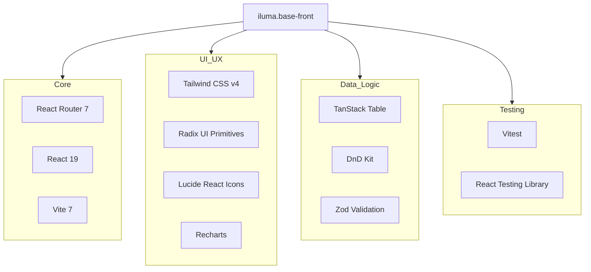

Sources: [package.json:18-105]()

### Server Entry & Rendering

The application uses a server-side entry point defined in `app/entry.server.tsx`. This file handles the initial request processing and response streaming. It differentiates between bot crawlers and standard user agents to optimize the rendering strategy (`onAllReady` vs. `onShellReady`).

**Key Logic:**

1.  **Bot Detection:** Uses `isbot` to detect crawlers.
2.  **Streaming:** Utilizes `renderToPipeableStream` from `react-dom/server`.
3.  **Timeout:** Enforces a 5-second stream timeout before aborting.

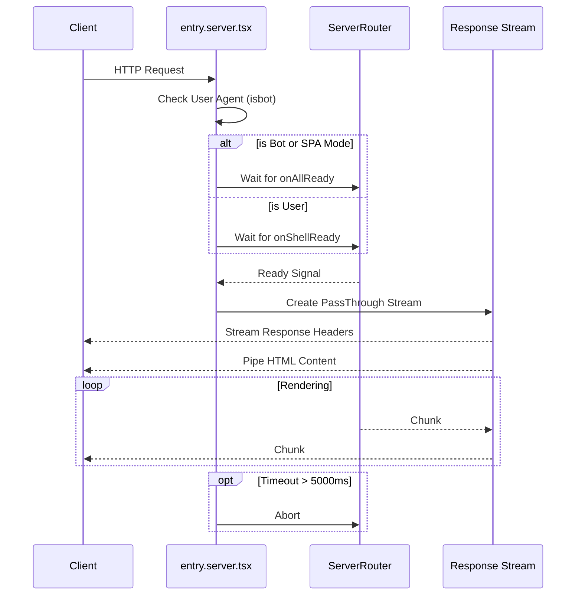

Sources: [app/entry.server.tsx:15-49]()

### Root Layout & Global Configuration

The `app/root.tsx` file serves as the main layout wrapper for the application. It establishes the HTML structure, loads global CSS, and initializes the `ThemeProvider`.

- **Links:** Preconnects to Google Fonts and loads `app.css`.
- **Structure:** Wraps content in `<html lang="es">` and `<body>`.
- **Providers:** Uses `ThemeProvider` (next-themes) for dark/light mode support.
- **Error Handling:** Exports an `ErrorBoundary` component that displays a styled error page with stack traces in development mode.

Sources: [app/root.tsx:28-66](), [app/root.tsx:82-108]()

## Styling System

The project uses **Tailwind CSS v4** configured via Vite. The global styles are defined in `app/app.css`, which utilizes CSS variables for theming.

### Theme Variables

The application defines a comprehensive set of CSS variables for colors, spacing, and shadows. These are scoped under `:root` for light mode and `.dark` for dark mode.

| Variable Category | Examples                                    | Description                                                 |
| :---------------- | :------------------------------------------ | :---------------------------------------------------------- |
| **Colors**        | `--background`, `--foreground`, `--primary` | Semantic color mapping for UI elements.                     |
| **Charts**        | `--chart-1` through `--chart-5`             | Color palette specifically for Recharts data visualization. |
| **Sidebar**       | `--sidebar-primary`, `--sidebar-accent`     | Specific variables for sidebar navigation components.       |
| **Shadows**       | `--shadow-sm`, `--shadow-xl`                | Elevation levels using HSL values.                          |

Sources: [app/app.css:1-60](), [package.json:91]()

## Component Library Structure

The project implements a UI component library pattern where headless primitives (mostly from Radix UI) are wrapped and styled within `app/components/ui/`.

### Implementation Pattern

Components typically follow this pattern:

1.  Import the primitive from `@radix-ui/*`.
2.  Import `cn` utility from `@/lib/utils` for class merging.
3.  Export a styled component using `React.forwardRef` or direct function components.
4.  Apply Tailwind classes via `className` props.

**Example: Sheet Component**
The `Sheet` component wraps `@radix-ui/react-dialog` to create slide-out panels. It includes variants for positioning (top, right, bottom, left) controlled by data attributes and Tailwind classes.

```typescript
// Snippet demonstrating the styled wrapper pattern
function SheetContent({
  className,
  children,
  side = "right",
  ...props
}: React.ComponentProps<typeof SheetPrimitive.Content> & {
  side?: "top" | "right" | "bottom" | "left"
}) {
  return (
    <SheetPortal>
      <SheetOverlay />
      <SheetPrimitive.Content
        data-slot="sheet-content"
        className={cn(
          "bg-background ... fixed z-50 flex flex-col gap-4 shadow-lg",
          // ... positioning logic based on 'side' prop
          className
        )}
        {...props}
      >
        {children}
        <SheetPrimitive.Close ... >
          <XIcon className="size-4" />
        </SheetPrimitive.Close>
      </SheetPrimitive.Content>
    </SheetPortal>
  )
}
```

Sources: [app/components/ui/sheet.tsx:57-83]()

## Testing Infrastructure

The project is configured with **Vitest** for unit and integration testing. It uses `jsdom` as the test environment to simulate browser behavior.

### Test Configuration

- **Environment:** `jsdom`
- **Libraries:** `@testing-library/react`, `@testing-library/user-event`, `@testing-library/jest-dom`.
- **Routing Tests:** Uses `createRoutesStub` (likely from Remix/React Router testing utils) to mock routing context during tests.

### Example Test Scenarios

Tests cover layout structure, responsive classes, theme rendering, and form interactions.

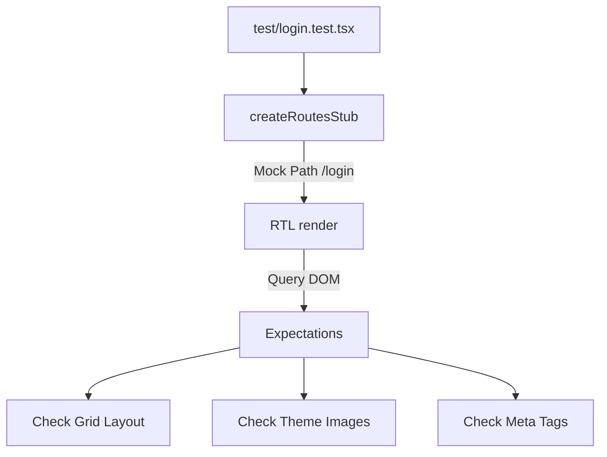

Sources: [package.json:84-103](), [test/login.test.tsx:2-45]()

---

<a id='arch-overview'></a>

## Architecture Overview

### Related Pages

Related topics: [Routing & Navigation](#routing-nav), [Authentication Flow](#auth-flow)

<details>
<summary>Relevant source files</summary>

The following files were used as context for generating this wiki page:

- [package.json](https://github.com/one-premex/iluma.base-front.git/blob/main/package.json)
- [app/routes.ts](https://github.com/one-premex/iluma.base-front.git/blob/main/app/routes.ts)
- [app/entry.server.tsx](https://github.com/one-premex/iluma.base-front.git/blob/main/app/entry.server.tsx)
- [app/root.tsx](https://github.com/one-premex/iluma.base-front.git/blob/main/app/root.tsx)
- [app/routes/(app)/layout.tsx](<https://github.com/one-premex/iluma.base-front.git/blob/main/app/routes/(app)/layout.tsx>)
- [app/routes/(app)/clients/route.tsx](<https://github.com/one-premex/iluma.base-front.git/blob/main/app/routes/(app)/clients/route.tsx>)
- [app/components/layouts/app-sidebar.tsx](https://github.com/one-premex/iluma.base-front.git/blob/main/app/components/layouts/app-sidebar.tsx)
- [app/components/layouts/data-table.tsx](https://github.com/one-premex/iluma.base-front.git/blob/main/app/components/layouts/data-table.tsx)

</details>

# Architecture Overview

## Introduction

The **Iluma Base Front** project is a modern web application architecture built upon **React Router 7** (formerly Remix patterns) and **Vite**. It employs a Server-Side Rendering (SSR) strategy with React 19, designed to provide a robust foundation for administrative interfaces. The architecture emphasizes a clear separation between authentication flows and the main application logic, utilizing route-based code splitting and data loading.

The system integrates a comprehensive UI component library based on **Radix UI** primitives and **Tailwind CSS v4**, ensuring accessibility and design consistency. It features advanced data handling capabilities including server-side pagination, authorization-wrapped loaders, and interactive data tables with drag-and-drop sorting.

Sources: [package.json:1-125](), [app/root.tsx:1-85]()

## Core Technology Stack

The application leverages a specific set of libraries to handle routing, state, and UI rendering.

| Category               | Technology      | Description                                    |
| :--------------------- | :-------------- | :--------------------------------------------- |
| **Framework**          | React Router 7  | Handles routing, loaders, and SSR.             |
| **Build Tool**         | Vite            | Provides fast development server and bundling. |
| **UI Library**         | React 19        | Latest React version with concurrent features. |
| **Styling**            | Tailwind CSS v4 | Utility-first CSS framework.                   |
| **Components**         | Radix UI        | Headless UI primitives for accessibility.      |
| **Data Visualization** | Recharts        | Composable charting library.                   |
| **Table Management**   | TanStack Table  | Headless table logic for sorting/filtering.    |
| **Drag & Drop**        | Dnd Kit         | Drag and drop utilities for table rows.        |
| **Testing**            | Vitest          | Unit and integration testing framework.        |

Sources: [package.json:15-65]()

## Routing and Layout Architecture

The application uses a configuration-based routing approach defined in `app/routes.ts`, rather than purely file-system based routing. This allows for explicit layout nesting and route definition.

### Route Hierarchy

The routing structure is divided into two primary layout groups:

1.  **(app)**: The protected area containing the dashboard, client management, and sidebar navigation.
2.  **(auth)**: The public area containing login and authentication flows.

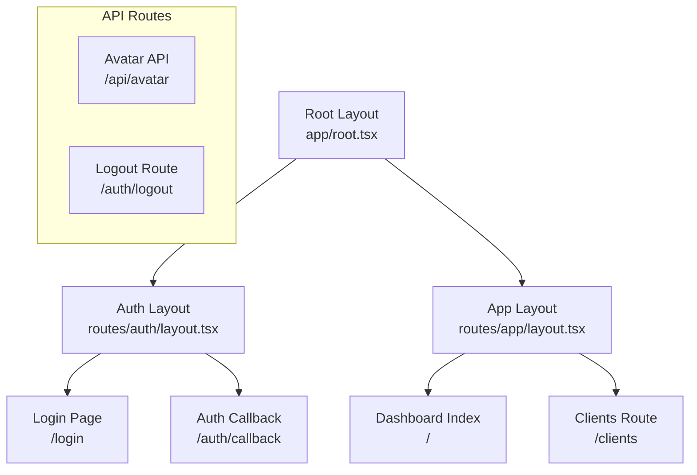

Sources: [app/routes.ts:1-18](), [app/root.tsx:50-65]()

### Root Layout Responsibilities

The `app/root.tsx` serves as the document shell. It handles:

- Global CSS injection.
- Theme Provider initialization (`next-themes`).
- Global Error Boundary implementation (handling 404s and stack traces).
- Meta tag management.

Sources: [app/root.tsx:39-85]()

## Server-Side Rendering (SSR) Strategy

The entry point for server rendering is managed in `app/entry.server.tsx`. The application uses Node.js streams to deliver content to the client, optimizing for Time to First Byte (TTFB).

### Request Handling Flow

The server entry distinguishes between bot crawlers and standard users to optimize the loading strategy (`onAllReady` vs. `onShellReady`).

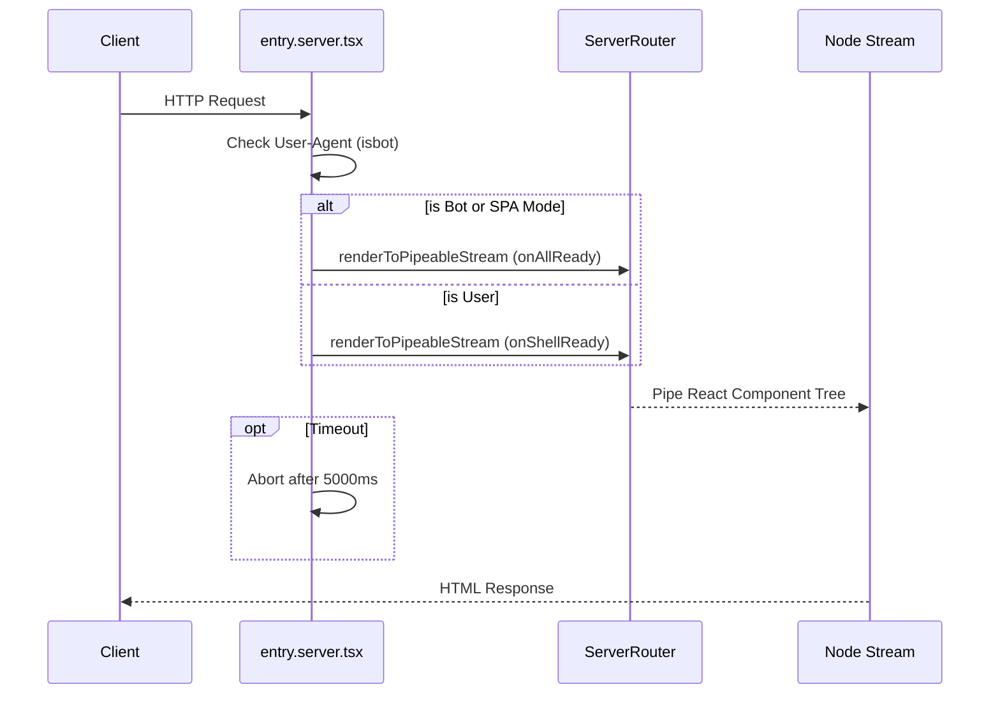

Sources: [app/entry.server.tsx:15-50]()

## Data Loading and Authorization

Data fetching is tightly coupled with routing via `loaders`. The application implements a Higher-Order Function (HOF) pattern to secure routes and inject user context.

### Authorized Loaders

Routes within the `(app)` layout utilize `AuthorizedLoader` or `AuthorizedLoaderWithFetcher`. This pattern ensures:

1.  The user is authenticated before the loader logic executes.
2.  Required permissions (e.g., `ae:create:clients`) are checked.
3.  Backend API calls are proxied or made directly.

### Client Data Flow

The `Clients` route demonstrates the pagination wiring. It ships with an empty array rather than a real fetch — the template does not know your endpoints — so replace the placeholder in its loader.

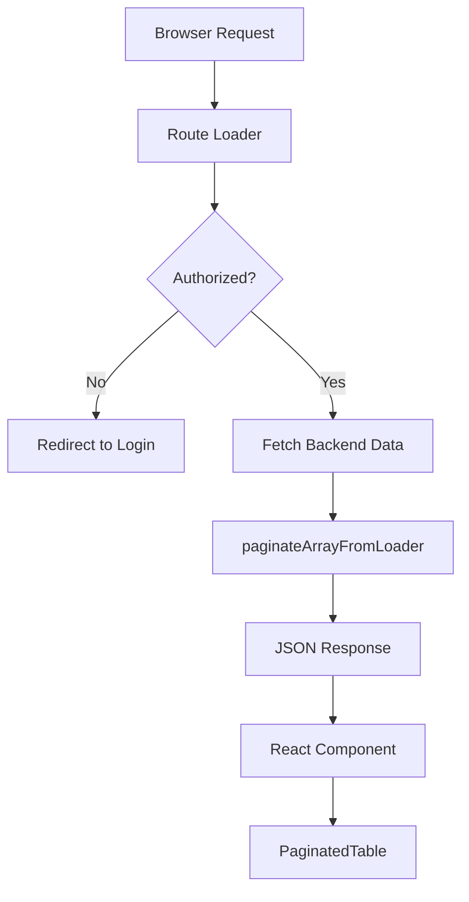

Sources: [app/routes/(app)/clients/route.tsx:23-34](), [app/routes/(app)/layout.tsx:10-17]()

## UI Component Architecture

The UI is modular, utilizing a "Sidebar Layout" pattern provided by `app/components/ui/sidebar.tsx` and a complex "Data Table" implementation.

### Application Shell

The `AppLayout` component wraps the authenticated routes. It injects the `SidebarProvider` and renders the `AppSidebar`.

- **SidebarProvider**: Manages the collapsed/expanded state of the sidebar.
- **AppSidebar**: Renders navigation items based on user permissions.
- **SidebarInset**: Contains the main content area (`Outlet`).

Sources: [app/routes/(app)/layout.tsx:19-42](), [app/components/layouts/app-sidebar.tsx:32-48]()

### Interactive Data Table

The `DataTable` component (`app/components/layouts/data-table.tsx`) is a high-complexity component combining multiple libraries:

- **TanStack Table**: Manages core table logic (sorting, filtering, pagination).
- **Dnd Kit**: Provides drag-and-drop reordering capabilities via `SortableContext` and `DraggableRow`.
- **Radix UI**: Used for dropdown menus and select inputs within the table.

**Key Components within DataTable:**

1.  `DragHandle`: A specific button using `useSortable` listeners to trigger row reordering.
2.  `DraggableRow`: Wraps table rows to enable vertical axis restriction during drag operations.

Sources: [app/components/layouts/data-table.tsx:1-125]()

## Testing Architecture

The project is configured for testing using **Vitest** and **React Testing Library**, as seen in `test/login.test.tsx`.

- **Stubbing**: Uses `createRoutesStub` from React Router to isolate route components during tests.
- **DOM Testing**: Checks for the presence of specific CSS classes (e.g., grid layouts, responsive utility classes) and accessibility attributes (ARIA roles).
- **Environment**: Tests run in `jsdom` environment.

Sources: [test/login.test.tsx:1-50](), [package.json:62-65]()

## Summary

The Iluma Base Front architecture prioritizes performance through streaming SSR and security through loader-level authorization. It adopts a modern, type-safe approach to routing and data management while leveraging a component-based UI system that supports complex interactions like drag-and-drop tables and responsive dashboards.

---

<a id='auth-flow'></a>

## Authentication Flow

### Related Pages

Related topics: [Architecture Overview](#arch-overview), [Routing & Navigation](#routing-nav)

<details>
<summary>Relevant source files</summary>

The following files were used as context for generating this wiki page:

- [app/lib/auth.server.ts](https://github.com/one-premex/iluma.base-front.git/blob/main/app/lib/auth.server.ts)
- [app/routes/(auth)/callback.ts](<https://github.com/one-premex/iluma.base-front.git/blob/main/app/routes/(auth)/callback.ts>)
- [app/routes/(auth)/login.tsx](<https://github.com/one-premex/iluma.base-front.git/blob/main/app/routes/(auth)/login.tsx>)
- [app/types/auth/index.ts](https://github.com/one-premex/iluma.base-front.git/blob/main/app/types/auth/index.ts)
- [app/routes/(app)/clients/route.tsx](<https://github.com/one-premex/iluma.base-front.git/blob/main/app/routes/(app)/clients/route.tsx>)
- [app/components/elements/nav-main.tsx](https://github.com/one-premex/iluma.base-front.git/blob/main/app/components/elements/nav-main.tsx)
- [package.json](https://github.com/one-premex/iluma.base-front.git/blob/main/package.json)

</details>

# Authentication Flow

## Introduction

The authentication system in the `iluma.base-front` application is built upon **Auth0** using the OpenID Connect (OIDC) protocol. It leverages `remix-auth` and `remix-auth-auth0` libraries to manage the authentication strategy within the Remix server-side environment. The system handles user login, callback processing, session management, and permission-based access control (RBAC). It also facilitates authenticated communication with backend services by injecting authentication tokens into API requests.

Sources: [app/lib/auth.server.ts:1-15](), [package.json:44-45]()

## Authentication Architecture

The core authentication logic is encapsulated in `app/lib/auth.server.ts`. This module configures the `Authenticator` instance and the `Auth0Strategy`.

### Components Overview

| Component            | Description                                                                           |
| :------------------- | :------------------------------------------------------------------------------------ |
| **Authenticator**    | An instance of `remix-auth` typed with `LoginType` (containing `tokenId` and `user`). |
| **Auth0Strategy**    | Configures the OAuth flow with domain, client secrets, and callback URI.              |
| **Session Storage**  | Manages the user session via cookies (imported from `sessions.server`).               |
| **UserInfoClient**   | An Auth0 client used to fetch detailed user profiles using access tokens.             |
| **ManagementClient** | An Auth0 client used to fetch user permissions.                                       |

Sources: [app/lib/auth.server.ts:34-45](), [app/lib/auth.server.ts:130-132]()

### Configuration

The `Auth0Strategy` is initialized with environment variables and specific scopes to ensure retrieval of necessary user claims.

```typescript
export const auth0Strategy = new Auth0Strategy(
  {
    domain: process.env.AUTH0_DOMAIN!,
    clientId: process.env.AUTH0_CLIENT_ID!,
    clientSecret: process.env.AUTH0_CLIENT_SECRET!,
    redirectURI: `${process.env.BASE_URL}/auth/callback`,
    scopes: ["openid", "email", "profile"],
  },
  // ... verify callback
);
```

Sources: [app/lib/auth.server.ts:36-43]()

## Login and Callback Process

The login flow is initiated from the client side and completed on the server side via a callback route.

### Login Route (`/login`)

The login page renders a UI allowing users to sign in via SSO.

- **Action:** The `action` function calls `authenticator.authenticate("auth0", request)`, which triggers the redirect to Auth0.
- **Error Handling:** Checks for `error` query parameters to display alerts (e.g., "You are not authorized").

Sources: [app/routes/(auth)/login.tsx:17-19](), [app/routes/(auth)/login.tsx:22]()

### Callback Route (`/auth/callback`)

The callback route handles the response from Auth0. It performs critical validation before establishing a session.

1.  **Authentication:** Calls `authenticator.authenticate` to exchange the code for tokens.
2.  **Validation:** Verifies that the user object exists, has permissions, and a valid `tokenId` exists.
3.  **Session Creation:** If valid, stores the `user` object and `tokenId` in the session.
4.  **Redirect:** Redirects to the dashboard (`/`) on success, or back to login with an error flag on failure.

Sources: [app/routes/(auth)/callback.ts:10-33]()

### Sequence Diagram: Authentication Flow

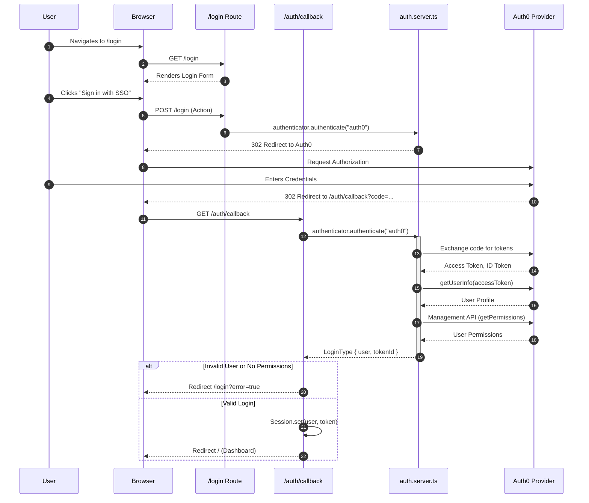

Sources: [app/routes/(auth)/login.tsx](), [app/routes/(auth)/callback.ts](), [app/lib/auth.server.ts]()

## Data Models

### User Profile (`AuthUser`)

The application defines a strict type for the authenticated user, extending standard Auth0 claims with application-specific permissions.

| Field         | Type       | Description                                              |
| :------------ | :--------- | :------------------------------------------------------- |
| `sub`         | `string`   | Unique user identifier (e.g., "auth0\|123").             |
| `name`        | `string`   | Full display name.                                       |
| `email`       | `string`   | User's email address.                                    |
| `permissions` | `string[]` | Array of permission strings (e.g., "ae:create:clients"). |
| `picture`     | `string`   | URL to the user's avatar.                                |

Sources: [app/types/auth/index.ts:40-66]()

### Session Data (`LoginType`)

The session stores a specific shape of data defined as `LoginType` in `auth.server.ts`.

```typescript
type LoginType = {
  /** The Auth0 ID token used for API authentication */
  tokenId: string;
  /** Complete user profile including permissions */
  user: AuthUser;
};
```

Sources: [app/lib/auth.server.ts:16-22]()

## API Integration and Protected Resources

The application uses the stored authentication context to secure routes and make authenticated requests to backend services.

### Authenticated Fetcher

A factory function `createAuthenticatedFetcher` is used to create a `fetch` wrapper. This wrapper automatically injects the Bearer token into the `Authorization` header.

- **Input:** `token` (string)
- **Output:** An object with one method per HTTP verb — `get`, `post`, `put`, `delete` — each returning `AppResponse<TData>`.
- **Behavior:**
  - Adds `Authorization: Bearer ${token}` header.
  - Constructs full URL using `process.env.BACKEND_URL`.
  - `post` and `put` JSON-encode the body and set `Content-Type` for you.
  - Handles 204 No Content.
  - Wraps responses in `AppResponse` structure.

```typescript
const { data, error } = await fetch.get<Client[]>("/clients");
await fetch.post("/clients", { name: "Acme" }); // body is encoded for you
await fetch.delete(`/clients/${id}`);
```

Paths are resolved against `BACKEND_URL` with the base path preserved, so
`"/clients"` and `"clients"` are equivalent. This differs from bare
`new URL()`, where a leading slash would discard any path prefix on
`BACKEND_URL` — see `backendUrl` in `app/lib/auth.server.ts`.

A **401 from the backend ends the session** and redirects to
`/login?error=expired`. Auth0 access tokens expire on their own schedule and
this app does not request a refresh token (the strategy asks for
`openid email profile`, not `offline_access`), so the token can die well
before the session's own 1-day expiry. Without this the user would sit on a
page of errors until the session lapsed. The redirect is thrown as a
`Response`, and the fetcher's `catch` re-throws `Response` instances rather
than converting them to error data — removing that re-throw silently strands
the user, so `test/authorization.test.ts` pins it.

Sources: [app/lib/auth.server.ts]()

### Route Protection

Routes use a Higher-Order Function (HOF) pattern (likely `AuthorizedLoaderWithFetcher`) to ensure the user is authenticated and has specific permissions before loading data.

**Example Usage in Clients Route:**
The loader checks for the permission. If authorized, it provides a configured `fetch` instance to the loader logic. If not, it throws a redirect to `/unauthorized`.

Permission strings come from `app/lib/permissions.ts` rather than being written inline, so the sidebar entry and the loader guarding the same section can't drift apart. They are grouped by domain (`PERMISSIONS.clients.create`) and the wrapper's parameter is typed as `Permission | ""`, so a misspelled permission fails to compile instead of silently redirecting the user to `/unauthorized`.

Only declare a permission there once something enforces it — Auth0 owns the full catalog, and mirroring all of it would create a second list that goes stale without anything failing.

> **Permissions are snapshotted at login and never re-checked.** They are read
> from the Auth0 Management API once, during `/auth/callback`, and stored in
> the session. **Revoking someone's access in Auth0 therefore has no effect
> until their session expires — up to 24 hours.** Nothing in the app shortens
> that window.
>
> This is a deliberate trade-off: re-reading permissions per request would put
> an Auth0 Management call on every loader. If your threat model can't accept
> a 24h revocation lag, the options are to shorten `SESSION_MAX_AGE` in
> `app/sessions.server.ts`, to re-fetch permissions on an interval and refresh
> the session, or to have the backend enforce authorization independently —
> which it should be doing regardless, since these checks only guard the UI.

The permission gate is exercised by `test/authorization.test.ts`, including
that the check runs _before_ the wrapped loader/action body, that a mutation
never executes for an unauthorized caller, and that permissions match exactly
rather than by prefix.

```typescript
export const loader = AuthorizedLoaderWithFetcher(
  PERMISSIONS.clients.create,
  async ({ request }, fetch, user) => {
    const todos = await fetch.get<Todo[]>("/todos");
    // ...
    return { user, ...paginationResult };
  },
);
```

Sources: [app/routes/(app)/clients/route.tsx]()

### Context Retrieval

`getAuthContext` returns the user, permissions and token from a **single**
session read, via `getAuthSession` in `app/sessions.server.ts`.

It used to `Promise.all` over three separate getters, each of which decoded
the cookie and read the store independently — three reads per loader, and both
the app layout and the page loader call it. That is cheap against an in-process
`Map` and stops being cheap the moment the store is anything else. Prefer
`getAuthSession` over combining `getUser` / `getPermissions` / `getToken`
yourself.

```typescript
async function getAuthContext(request: Request): Promise<AuthContext> {
  return getAuthSession(request);
}
```

Sources: [app/lib/auth.server.ts](), [app/sessions.server.ts]()

### Session Storage

Sessions are stored **server-side**; the cookie carries only an opaque id.
The payload (Auth0 access token plus the permissions array) would otherwise
exceed the ~4KB browser cookie limit.

The store lives in `app/lib/session-store.server.ts`. The only implementation
today is an in-process `Map`, which carries two constraints that stay
invisible until they bite:

> ⚠️ **The app must run as a single instance.** A session created on one
> instance is invisible to the others, so the user bounces between `/login`
> and the app forever — no error, nothing logged.
>
> ⚠️ **Every deploy or restart signs all users out**, because sessions live
> and die with the Node process.

The app logs a warning to that effect on every production boot, so the reason
is already in the logs when someone eventually scales the service out.

Sessions reach the store through a four-method `SessionStore` interface, so
moving to a shared backend (Redis, Postgres, DynamoDB) means adding one more
implementation in that file — `app/sessions.server.ts` and every route stay
exactly as they are.

```typescript
export interface SessionStore {
  create(data: SessionRecord, expiresAt: Date): Promise<string>;
  read(id: string): Promise<SessionRecord | null>;
  update(id: string, data: SessionRecord, expiresAt: Date): Promise<void>;
  destroy(id: string): Promise<void>;
}
```

### Session Invariants

Three rules that the storage rewrite makes load-bearing. All three are pinned
by `test/sessions.test.ts`; the fixation test fails if the callback stops
rotating.

**1. Rotate the session id at every authentication boundary.** `commitSession`
writes into `session.id` whenever one is present — and React Router keeps the
id parsed from the cookie _even when the store had no entry for it_. Committing
the session parsed from the request would therefore file the authenticated user
under an id the visitor chose. That is session fixation (CWE-384): an attacker
who plants a validly-signed cookie in someone's browser holds a live session for
them the moment they log in, inheriting their permissions and their Auth0 access
token — and signing a cookie costs nothing, they just log in and copy their own.
Use `rotateSession(session)` before storing the user, as `(auth)/callback.ts`
does.

**2. `SessionStore.update` must never create.** It refreshes an existing entry
or does nothing. A creating `update` lets a signed cookie resurrect any id,
which is what makes rule 1 exploitable even against ids the store never issued.

**3. Do not attach a `Set-Cookie` when redirecting an unauthenticated visitor
to `/login`.** An id-less session sends `commitSession` down `createData`, so
committing there writes a throwaway store entry on every anonymous request —
and `getAuthContext` used to fan out to three of those guards per loader.
`redirectToLogin` handles this correctly.

The cookie is named `__Host-session` in production. The prefix makes browsers
reject it unless it is `Secure`, `Path=/` and carries no `Domain`, which stops a
sibling subdomain from writing it and stops a narrower path from shadowing it.
Outside production the plain name is used, because `__Host-` requires `Secure`
and the dev server is HTTP.

Sources: [app/lib/session-store.server.ts](), [app/sessions.server.ts]()

## Frontend Permission Handling

The frontend utilizes the user object stored in the session to conditionally render UI elements based on permissions.

### Access Levels

Authorization is resolved at three distinct levels, each with its own destination. Keeping them separate is what prevents redirect loops: a route that gates on a permission must never redirect to itself on failure.

| Situation                                     | Destination           | Enforced in                     |
| :-------------------------------------------- | :-------------------- | :------------------------------ |
| No session                                    | `/login`              | `app/sessions.server.ts`        |
| Signed in, zero permissions                   | `/login?error=true`   | `app/routes/(auth)/callback.ts` |
| Signed in, missing the permission for a route | `/unauthorized`       | `app/lib/auth.server.ts`        |
| Signed in, any permissions                    | `/` (permission-free) | `app/routes/(app)/route.tsx`    |

The index route `/` is deliberately permission-free so every signed-in user has somewhere to land, and lists the sections their permissions grant.

### Navigation Menu

`NavMain` filters menu items with the shared `canAccess` helper. Entries without a `permission` are visible to every authenticated user.

```typescript
export const canAccess = (item: NavItem, permissions: string[]) =>
  !item.permission || permissions.includes(item.permission);
```

Sources: [app/lib/navigation.ts](), [app/components/elements/nav-main.tsx]()

### Logic Flow: Permission Checking

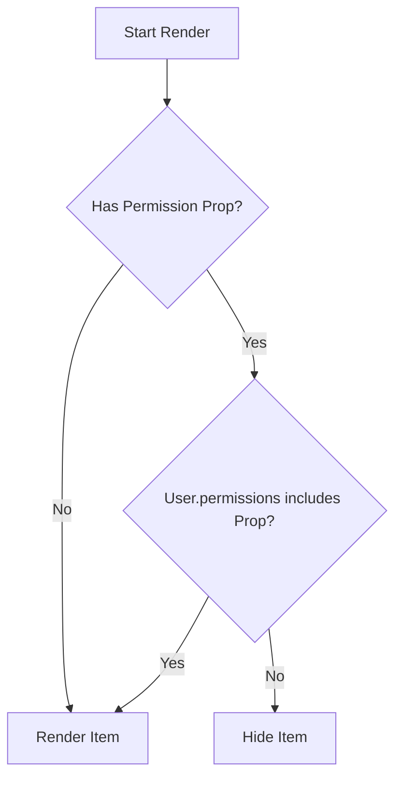

Sources: [app/components/elements/nav-main.tsx]()

---

<a id='routing-nav'></a>

## Routing & Navigation

### Related Pages

Related topics: [Architecture Overview](#arch-overview)

<details>
<summary>Relevant source files</summary>

The following files were used as context for generating this wiki page:

- [app/routes.ts](https://github.com/one-premex/iluma.base-front.git/blob/main/app/routes.ts)
- [app/root.tsx](https://github.com/one-premex/iluma.base-front.git/blob/main/app/root.tsx)
- [app/routes/(app)/layout.tsx](<https://github.com/one-premex/iluma.base-front.git/blob/main/app/routes/(app)/layout.tsx>)
- [app/components/layouts/app-sidebar.tsx](https://github.com/one-premex/iluma.base-front.git/blob/main/app/components/layouts/app-sidebar.tsx)
- [app/components/elements/nav-main.tsx](https://github.com/one-premex/iluma.base-front.git/blob/main/app/components/elements/nav-main.tsx)
- [app/routes/(app)/clients/route.tsx](<https://github.com/one-premex/iluma.base-front.git/blob/main/app/routes/(app)/clients/route.tsx>)
- [app/components/layouts/paginated-table.tsx](https://github.com/one-premex/iluma.base-front.git/blob/main/app/components/layouts/paginated-table.tsx)
- [app/entry.server.tsx](https://github.com/one-premex/iluma.base-front.git/blob/main/app/entry.server.tsx)

</details>

# Routing & Navigation

## Introduction

The `iluma.base-front` application utilizes **React Router v7** for handling client-side and server-side routing. The routing architecture is defined programmatically using a route configuration object, supporting nested layouts, index routes, and protected paths. The system integrates navigation directly with authentication and authorization mechanisms, ensuring that menu items and routes are accessible only to users with specific permissions.

The application employs Server-Side Rendering (SSR) via `ServerRouter` to deliver initial content, followed by client-side hydration.

Sources: [package.json:44](), [app/entry.server.tsx:37](), [app/routes.ts:1-17]()

## Route Configuration & Hierarchy

The application's route structure is centralized in `app/routes.ts`. It uses the `RouteConfig` pattern to define a tree of layouts and routes. The hierarchy is divided primarily into an authenticated application layout (`(app)`) and an authentication layout (`(auth)`).

### Configuration Structure

The configuration separates the main application logic from authentication flows and standalone API endpoints.

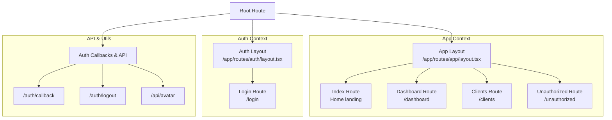

Sources: [app/routes.ts:7-17]()

### Key Route Definitions

| Path             | File Path                                 | Type     | Permission                   | Description                                                    |
| :--------------- | :---------------------------------------- | :------- | :--------------------------- | :------------------------------------------------------------- |
| `/`              | `app/routes/(app)/route.tsx`              | Index    | _none_                       | Home landing; lists the sections the user's permissions grant. |
| `/dashboard`     | `app/routes/(app)/dashboard/route.tsx`    | Route    | `PERMISSIONS.clients.create` | Metrics, charts and activity table.                            |
| `/clients`       | `app/routes/(app)/clients/route.tsx`      | Route    | `PERMISSIONS.clients.create` | Displays the paginated clients table.                          |
| `/unauthorized`  | `app/routes/(app)/unauthorized/route.tsx` | Route    | _none_                       | Shown when a signed-in user lacks a route's permission.        |
| `/login`         | `app/routes/(auth)/login.tsx`             | Route    | _none_                       | The login page, wrapped in the Auth Layout.                    |
| `/auth/callback` | `app/routes/(auth)/callback.ts`           | Resource | _none_                       | Handles authentication callbacks.                              |
| `/api/avatar`    | `app/routes/api.avatar.tsx`               | Resource | _none_                       | Serves user avatars.                                           |

`/` and `/unauthorized` must stay permission-free: they are the fallback destinations, and gating them would make them redirect to themselves.

Sources: [app/routes.ts]()

## Navigation Components

Navigation within the application is primarily handled by a sidebar component that conditionally renders links based on the authenticated user's permissions.

### Sidebar Architecture

The `AppLayout` wraps the main content with a `SidebarProvider` and renders the `AppSidebar`.

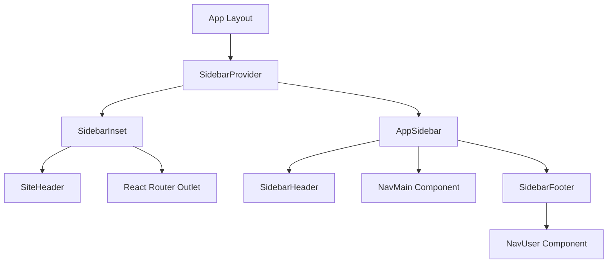

Sources: [app/routes/(app)/layout.tsx:21-39](), [app/components/layouts/app-sidebar.tsx:34-45]()

### Permission-Based Navigation

The `NavMain` component is responsible for rendering the navigation menu. It filters navigation items against the user's permissions before rendering them.

- **Input:** Receives a list of `NavItem`s and the `AuthUser` object.
- **Logic:** Filters items through `canAccess`; entries without a `permission` are always shown.
- **Active State:** Each entry renders as a `NavMainItem`, which calls `useMatch` once — hooks must not be called inside a loop whose length varies.

```typescript
// Example from app/components/elements/nav-main.tsx
export function NavMain({ items, user }: { user: AuthUser; items: NavItem[] }) {
  return (
    <SidebarGroup>
      <SidebarMenu>
        {items
          .filter((item) => canAccess(item, user.permissions))
          .map((item) => (
            <NavMainItem key={item.title} item={item} />
          ))}
      </SidebarMenu>
    </SidebarGroup>
  );
}
```

Sources: [app/components/elements/nav-main.tsx]()

### Navigation Data Structure

Navigation lives in `app/lib/navigation.ts` — a single source of truth consumed by both the sidebar and the home landing, so a section is declared once. The entries below are placeholders to be replaced with the app's real sections.

| Title     | URL          | Permission Required          | Description                   |
| :-------- | :----------- | :--------------------------- | :---------------------------- |
| Home      | `/`          | _none_                       | Your available sections       |
| Dashboard | `/dashboard` | `PERMISSIONS.clients.create` | Metrics and activity overview |
| Clients   | `/clients`   | `PERMISSIONS.clients.create` | Browse and manage clients     |

Adding a section means adding one entry here plus a route in `app/routes.ts` whose loader gates on the same `PERMISSIONS` constant.

Sources: [app/lib/navigation.ts](), [app/lib/permissions.ts]()

## Data Loading & Route Protection

Routes use specific loader utilities to ensure data is fetched only for authorized users. This is tightly coupled with the routing lifecycle.

### Authorized Loaders

The application uses `AuthorizedLoader` and `AuthorizedLoaderWithFetcher` to protect routes. These wrappers verify the user's session before the route component renders.

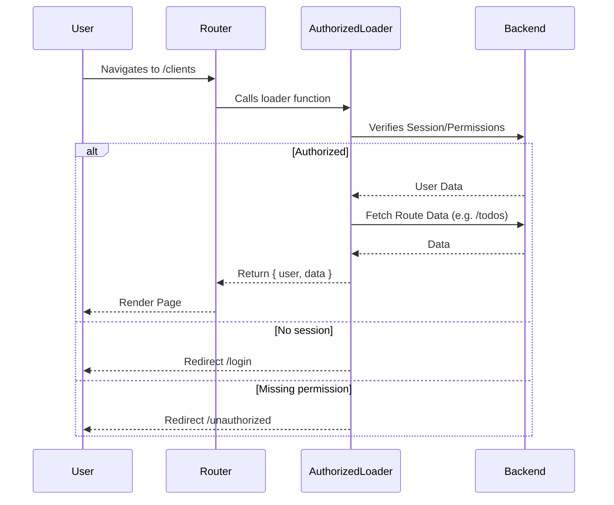

Sources: [app/routes/(app)/clients/route.tsx:22-33](), [app/routes/(app)/layout.tsx:10-16]()

## Pagination & URL State Management

The application implements navigation-based pagination where the state (page number, page size) is stored in the URL query parameters rather than local component state. This allows for shareable URLs and browser history integration.

### Implementation Details

The `PaginatedTable` component and helper functions manage URL generation for pagination controls.

- **Query Parameters:** Uses `page` and `pageSize`.
- **Navigation Logic:** The component generates new URLs by modifying `URLSearchParams` and updating the link targets.

```typescript
// Logic from app/components/layouts/paginated-table.tsx
const nextPageUrl = () => {
  const urlParams = new URLSearchParams(searchParams);
  urlParams.set("page", (pagination.page + 1).toString());
  urlParams.set("pageSize", pagination.pageSize.toString());
  return `?${urlParams.toString()}`;
};
```

### Data Fetching Integration

The route loader parses these parameters to fetch the correct slice of data.

- **Function:** `paginateArrayFromLoader`
- **Usage:** In `loader` functions, this utility extracts pagination parameters from the `request` object to filter the dataset.

Sources: [app/components/layouts/paginated-table.tsx:5-22](), [app/routes/(app)/clients/route.tsx:27-30]()

## Error Handling

The root route (`app/root.tsx`) exports an `ErrorBoundary` component. This component catches errors thrown during routing (loaders, actions, or rendering) and displays a user-friendly error page.

- **Route Errors:** Handles 404s explicitly (`isRouteErrorResponse`).
- **Development:** Displays stack traces when `import.meta.env.DEV` is true.
- **Navigation:** Provides "Go Back" and "Go Home" buttons to help the user recover navigation context.

Sources: [app/root.tsx:60-123]()

---

<a id='dashboard-analytics'></a>

## Dashboard & Analytics

### Related Pages

Related topics: [UI Library & Theming](#ui-library-theming)

<details>
<summary>Relevant source files</summary>

The following files were used as context for generating this wiki page:

- [app/routes/(app)/route.tsx](<https://github.com/one-premex/iluma.base-front.git/blob/main/app/routes/(app)/route.tsx>)
- [app/components/dashboard/chart-area-interactive.tsx](https://github.com/one-premex/iluma.base-front.git/blob/main/app/components/dashboard/chart-area-interactive.tsx)
- [app/components/layouts/data-table.tsx](https://github.com/one-premex/iluma.base-front.git/blob/main/app/components/layouts/data-table.tsx)
- [app/components/ui/chart.tsx](https://github.com/one-premex/iluma.base-front.git/blob/main/app/components/ui/chart.tsx)
- [app/app.css](https://github.com/one-premex/iluma.base-front.git/blob/main/app/app.css)
- [app/components/layouts/app-sidebar.tsx](https://github.com/one-premex/iluma.base-front.git/blob/main/app/components/layouts/app-sidebar.tsx)
- [package.json](https://github.com/one-premex/iluma.base-front.git/blob/main/package.json)

</details>

# Dashboard & Analytics

## Introduction

The Dashboard & Analytics module serves as the primary entry point for the application, providing authenticated users with a high-level overview of system metrics, interactive data visualizations, and data management capabilities. It is designed to aggregate critical business information, such as "Todos" or "Clients," into a cohesive interface that supports both viewing and manipulation of data.

The dashboard integrates three core visual components: summary section cards, an interactive area chart for temporal data analysis, and a complex data table supporting drag-and-drop reordering and multi-view tabs. The architecture leverages React Router for data loading and `recharts` for visualization, wrapped within a responsive layout that adapts to mobile and desktop viewports.

Sources: [app/routes/(app)/route.tsx:27-37](), [app/components/dashboard/chart-area-interactive.tsx:15-20]()

## Dashboard Route Architecture

The dashboard is rendered via `app/routes/(app)/dashboard/route.tsx` at `/dashboard`. It utilizes a server-side loader to fetch initial data securely before rendering the client-side interface. (The index route `/` is a permission-free landing, not the dashboard.)

### Data Loading and Security

The route employs an `AuthorizedLoaderWithFetcher` gated on `PERMISSIONS.clients.create`, so only authorized users reach the data; everyone else is redirected to `/unauthorized`. The loader fetches a list of items (typed as `Todo[]`) which are then passed to the component props.

Sources: [app/routes/(app)/dashboard/route.tsx]()

### Component Hierarchy

The dashboard page layout is composed of three distinct vertical sections:

1.  **SectionCards**: Displays high-level metrics (implementation details abstract).
2.  **ChartAreaInteractive**: A visual representation of data trends over time.
3.  **DataTable**: A detailed, tabular view of the fetched data.

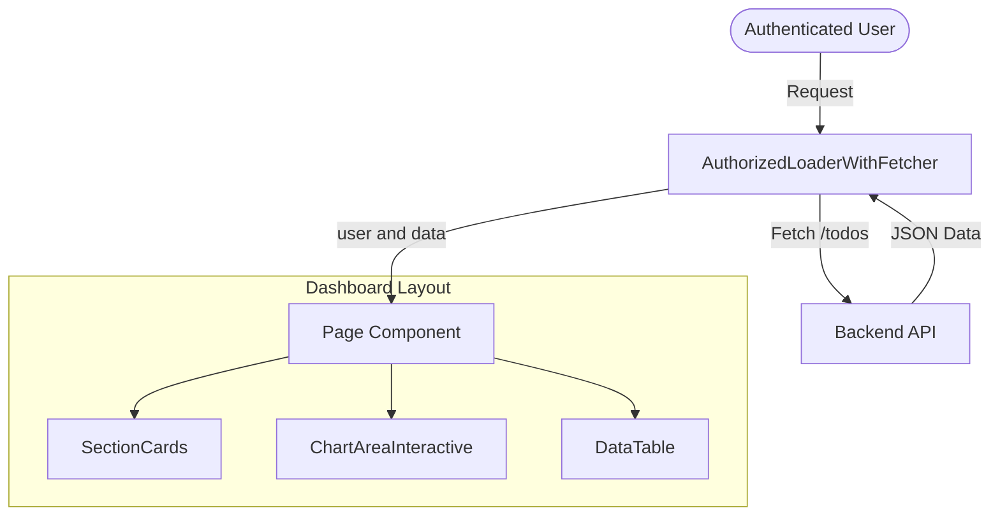

Sources: [app/routes/(app)/route.tsx:27-37]()

## Interactive Analytics (Charts)

The analytics section is powered by the `ChartAreaInteractive` component, which utilizes the `recharts` library to render responsive area charts.

### Chart Configuration

The chart system is built upon a flexible configuration object (`ChartConfig`) that maps data keys to display labels and theme colors. The visual style is controlled via CSS variables defined in the global theme, allowing for dark/light mode compatibility.

| Feature            | Description   | Implementation                                       |
| :----------------- | :------------ | :--------------------------------------------------- |
| **Library**        | Recharts      | `Area`, `AreaChart`, `CartesianGrid`, `XAxis`        |
| **Theme**          | CSS Variables | `--chart-1` through `--chart-5` defined in `app.css` |
| **Interactivity**  | Tooltips      | Custom `ChartTooltip` and `ChartTooltipContent`      |
| **Responsiveness** | Mobile Hooks  | `useIsMobile` hook adjusts layout                    |

Sources: [app/components/dashboard/chart-area-interactive.tsx:1-20](), [app/components/ui/chart.tsx:23-55](), [app/app.css:32-36]()

### Data Structure

The chart consumes an array of objects where each object represents a data point in time, containing values for different series (e.g., "desktop", "mobile").

```javascript
// Example Data Structure
const chartData = [
  { date: "2024-04-01", desktop: 222, mobile: 150 },
  { date: "2024-04-02", desktop: 97, mobile: 180 },
  // ...
];
```

Sources: [app/components/dashboard/chart-area-interactive.tsx:30-35]()

## Advanced Data Tables

The `DataTable` component is a sophisticated data grid built on `@tanstack/react-table` and `@dnd-kit`. It goes beyond simple data display by incorporating drag-and-drop reordering, tabbed views, and column management.

### Architecture & Capabilities

1.  **Tabbed Views**: The table is wrapped in a `Tabs` component, allowing users to switch between "Outline", "Past Performance", "Key Personnel", and "Focus Documents".
2.  **Drag and Drop**: Rows can be reordered using a drag handle. This is implemented using `DndContext` restricted to the vertical axis.
3.  **Column Management**: Users can toggle column visibility and sort data.

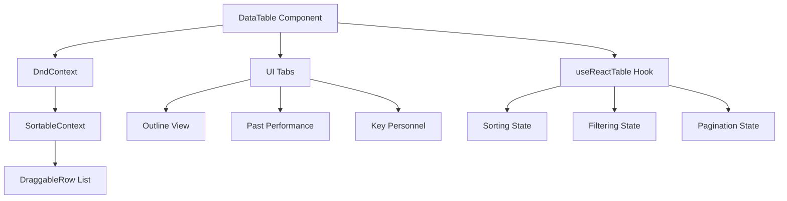

Sources: [app/components/layouts/data-table.tsx:1-50](), [app/components/layouts/data-table.tsx:145-160]()

### Drag and Drop Logic

The reordering logic uses `arrayMove` from `@dnd-kit/sortable` to update the local state when a drag event concludes.

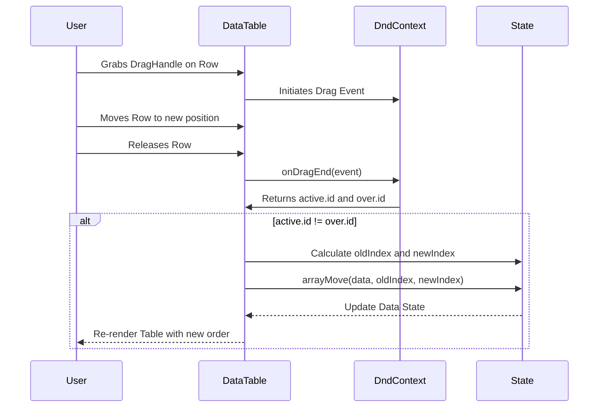

Sources: [app/components/layouts/data-table.tsx:135-144]()

### Table Schema & Columns

The table relies on Zod for schema validation and defines columns with specific accessors.

| Column Key  | Header    | Type    | Special Features                  |
| :---------- | :-------- | :------ | :-------------------------------- |
| `id`        | ID        | String  | Used as unique identifier for DnD |
| `title`     | Title     | String  | Standard text display             |
| `completed` | Completed | Boolean | Status indicator                  |
| `userId`    | User ID   | Number  | numeric identifier                |

Sources: [app/components/layouts/data-table.tsx:64-85]()

## Navigation & Sidebar Integration

The dashboard is accessible via the application sidebar, which renders the shared navigation defined in `app/lib/navigation.ts`. Navigation items are permission-gated, ensuring users only see routes they are authorized to access.

```typescript
// app/lib/navigation.ts
export const nav: NavItem[] = [
  { title: "Home", url: "/", icon: House },
  {
    title: "Dashboard",
    url: "/dashboard",
    icon: Gauge,
    permission: PERMISSIONS.clients.create,
  },
  // ...
];
```

The sidebar uses a `SidebarProvider` in the layout to manage state (expanded/collapsed) and provides visual consistency across the application.

Sources: [app/lib/navigation.ts](), [app/routes/(app)/layout.tsx]()

## Summary

The Dashboard & Analytics module in `iluma.base-front` provides a robust foundation for data visualization and management. By combining `recharts` for analytics and `@tanstack/react-table` with `@dnd-kit` for complex list operations, it delivers a highly interactive user experience. The architecture separates data fetching (loaders) from presentation, ensuring security and performance, while the shared theme system maintains visual consistency.

---

<a id='client-management'></a>

## Client Management

### Related Pages

Related topics: [Data Tables & Pagination](#tables-pagination)

<details>
<summary>Relevant source files</summary>

The following files were used as context for generating this wiki page:

- [app/routes/(app)/clients/route.tsx](<https://github.com/one-premex/iluma.base-front.git/blob/main/app/routes/(app)/clients/route.tsx>)
- [app/components/layouts/app-sidebar.tsx](https://github.com/one-premex/iluma.base-front.git/blob/main/app/components/layouts/app-sidebar.tsx)
- [app/lib/auth.server.ts](https://github.com/one-premex/iluma.base-front.git/blob/main/app/lib/auth.server.ts)
- [app/components/layouts/data-table.tsx](https://github.com/one-premex/iluma.base-front.git/blob/main/app/components/layouts/data-table.tsx)
- [app/routes/(app)/route.tsx](<https://github.com/one-premex/iluma.base-front.git/blob/main/app/routes/(app)/route.tsx>)
- [app/components/elements/nav-main.tsx](https://github.com/one-premex/iluma.base-front.git/blob/main/app/components/elements/nav-main.tsx)

</details>

# Client Management

## Introduction

The Client Management module within the Iluma Base Front application provides a secure interface for viewing and managing client data. It is integrated into the application's main navigation structure and utilizes server-side data fetching with client-side rendering capabilities. The module is designed to handle paginated data, enforce role-based access control, and present information through interactive table components.

The implementation serves as a foundation, establishing the architectural patterns for routing, authentication and layout composition. The route loaders deliberately fetch nothing — they return an empty array with a comment showing where to add your own call.

Sources: [app/routes/(app)/clients/route.tsx:1-35](), [app/components/layouts/app-sidebar.tsx:17-26]()

## Routing and Navigation

### Route Configuration

The Client Management feature is accessible via the `/clients` route. The route is defined using React Router 7's file-system routing conventions. It includes metadata definitions for SEO and browser tab titling.

- **URL Path:** `/clients`
- **Handle:** `{ title: "Clients" }`
- **Meta Title:** "Clients"

Sources: [app/routes/(app)/clients/route.tsx:11-20]()

### Sidebar Integration

Access to the module is controlled via the `AppSidebar` component. The navigation item is conditionally rendered based on user permissions.

- **Navigation Title:** "Clients"
- **Icon:** `Users` (Lucide React)
- **Required Permission:** `ae:create:clients`

The navigation logic filters items against the user's permission set before rendering, ensuring that unauthorized users do not see the link in the sidebar.

Sources: [app/components/layouts/app-sidebar.tsx:17-26](), [app/components/elements/nav-main.tsx:23-25]()

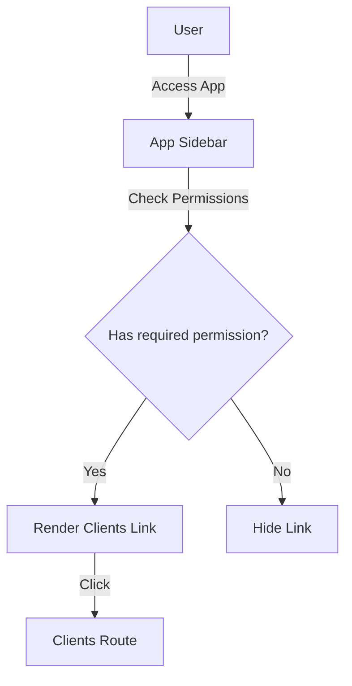

## Data Loading and Authentication

### Server-Side Loader

The data loading strategy employs the `AuthorizedLoaderWithFetcher` utility. This higher-order function performs two critical tasks:

1.  **Authentication:** It verifies the user's session and checks for the specific permission `ae:create:clients`.
2.  **Data Fetching:** It injects a configured `fetch` client for retrieving data. The template's loaders do not call it — add your own endpoint.

The loader also handles server-side pagination using `paginateArrayFromLoader`, returning a structured response containing the user profile, data array, and pagination metadata.

Sources: [app/routes/(app)/clients/route.tsx:22-33](), [app/lib/auth.server.ts:98-110]()

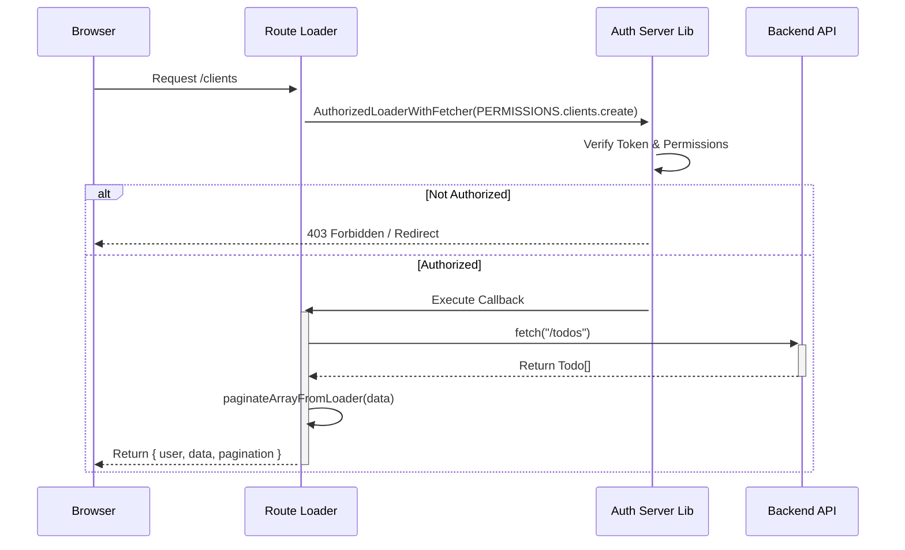

## User Interface Components

### Paginated Table

The main view utilizes a `PaginatedTable` component to display the data. This component is designed to handle structured data presentation and includes controls for adding new entries.

- **Data Input:** Receives `data` and `pagination` objects from the loader.
- **Columns:** Defines columns such as "ID".
- **Actions:** Includes a "New Client" button linking to `/clients/new`.

Sources: [app/routes/(app)/clients/route.tsx:35-50]()

### Data Table Features (Interactive)

The underlying `DataTable` implementation supports advanced interactive features, as seen in the component definitions.

- **View Modes:** Users can switch between different views using a `Tabs` interface:
  - Outline
  - Past Performance
  - Key Personnel
  - Focus Documents
- **Drag and Drop:** Implements `@dnd-kit` for vertical reordering of rows using `SortableContext` and `DraggableRow`.
- **Column Customization:** Allows users to toggle column visibility.

Sources: [app/components/layouts/data-table.tsx:1-120]()

### Table Data Schema

The data table enforces a strict schema using Zod for validation and type safety.

| Field       | Type    | Description                                    |
| :---------- | :------ | :--------------------------------------------- |
| `userId`    | number  | The ID of the user associated with the record. |
| `id`        | string  | Unique identifier for the record.              |
| `title`     | string  | The title or name of the item.                 |
| `completed` | boolean | Status indicator.                              |

Sources: [app/components/layouts/data-table.tsx:85-90]()

## Dependencies and Libraries

The Client Management module relies on several key libraries to function:

| Library                 | Usage                                             |
| :---------------------- | :------------------------------------------------ |
| `react-router`          | Routing, Loaders, and Navigation.                 |
| `@tanstack/react-table` | Headless UI logic for the data table.             |
| `@dnd-kit/core`         | Drag-and-drop primitives for row reordering.      |
| `zod`                   | Schema validation for table data.                 |
| `lucide-react`          | UI icons (e.g., `Users`, `Plus`, `GripVertical`). |

Sources: [package.json:20-60]()

## Code Implementation Details

### Loader Implementation

The following snippet demonstrates how the route loader combines authentication and data fetching:

```typescript
export const loader = AuthorizedLoaderWithFetcher(
  PERMISSIONS.clients.create,
  async ({ request }, fetch, user) => {
    const todos = await fetch.get<Todo[]>("/todos");
    // You can also use parsePaginationParams if your backend supports pagination
    const paginationResult = await paginateArrayFromLoader(
      todos.data || [],
      request,
    );
    return { user, ...paginationResult };
  },
);
```

Sources: [app/routes/(app)/clients/route.tsx:22-33]()

### Drag-and-Drop Row Logic

The `DataTable` component integrates drag-and-drop functionality for row reordering:

```typescript
function DragHandle({ id }: { id: number }) {
  const { attributes, listeners } = useSortable({
    id,
  });

  return (
    <Button
      {...attributes}
      {...listeners}
      variant="ghost"
      size="icon"
      className="text-muted-foreground size-7 hover:bg-transparent"
    >
      <GripVertical className="text-muted-foreground size-3" />
      <span className="sr-only">Drag to reorder</span>
    </Button>
  );
}
```

Sources: [app/components/layouts/data-table.tsx:93-109]()

---

<a id='ui-library-theming'></a>

## UI Library & Theming

### Related Pages

Related topics: [Dashboard & Analytics](#dashboard-analytics)

<details>
<summary>Relevant source files</summary>

The following files were used as context for generating this wiki page:

- [package.json](https://github.com/one-premex/iluma.base-front.git/blob/main/package.json)
- [app/app.css](https://github.com/one-premex/iluma.base-front.git/blob/main/app/app.css)
- [app/root.tsx](https://github.com/one-premex/iluma.base-front.git/blob/main/app/root.tsx)
- [app/components/ui/sidebar.tsx](https://github.com/one-premex/iluma.base-front.git/blob/main/app/components/ui/sidebar.tsx)
- [app/components/ui/chart.tsx](https://github.com/one-premex/iluma.base-front.git/blob/main/app/components/ui/chart.tsx)
- [app/components/layouts/data-table.tsx](https://github.com/one-premex/iluma.base-front.git/blob/main/app/components/layouts/data-table.tsx)
- [app/components/ui/sheet.tsx](https://github.com/one-premex/iluma.base-front.git/blob/main/app/components/ui/sheet.tsx)
- [app/components/ui/dropdown-menu.tsx](https://github.com/one-premex/iluma.base-front.git/blob/main/app/components/ui/dropdown-menu.tsx)

</details>

# UI Library & Theming

## Introduction

The `iluma.base-front` project utilizes a modern frontend architecture built on **React 19** and **React Router v7**. The UI library is constructed using a "headless" component approach, leveraging **Radix UI** primitives for accessibility and functionality, styled with **Tailwind CSS**.

The system implements a comprehensive theming engine supporting light and dark modes via CSS variables and `next-themes`. The component architecture follows the Shadcn/ui pattern, where components are defined within the local codebase (`app/components/ui`) rather than imported from a monolithic library, allowing for granular control over styling and behavior.

Sources: [package.json:34-60](), [app/app.css:1-5](), [app/root.tsx:55-70]()

---

## Global Theming Architecture

The application's visual design is driven by CSS variables defined in `app/app.css`. These variables are mapped to Tailwind CSS utility classes, allowing for semantic color usage (e.g., `bg-primary`, `text-muted-foreground`) that automatically adapts to the active color scheme.

### CSS Variable Configuration

The `app/app.css` file defines the root variables and the dark mode overrides. The project uses the `@theme` directive, indicating usage of Tailwind CSS v4 or a compatible configuration for extending the theme.

**Key Theme Variables:**

| Variable       | Description           | Light Mode Value | Dark Mode Value |
| :------------- | :-------------------- | :--------------- | :-------------- |
| `--background` | Page background color | `#ffffff`        | `#1f262e`       |
| `--foreground` | Default text color    | `#33404d`        | `#ffffff`       |
| `--primary`    | Primary brand color   | `#1e3832`        | `#1e3832`       |
| `--muted`      | Muted backgrounds     | `#f1f2f4`        | `#2b333b`       |
| `--border`     | Border color          | `#d5d7dd`        | `#454d54`       |
| `--radius`     | Base border radius    | `0.5rem`         | `0.5rem`        |
| `--sidebar`    | Sidebar background    | `#fafafa`        | `#131a20`       |

Sources: [app/app.css:17-140]()

### Theme Provider Integration

The application wraps the root layout in a `ThemeProvider` (likely a wrapper around `next-themes`), which manages the `class` attribute on the `<html>` element to toggle between light and dark modes.

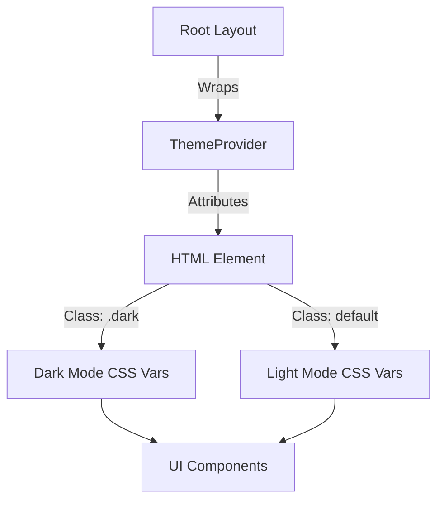

Sources: [app/root.tsx:55-73](), [app/app.css:105-140]()

---

## Component Library Architecture

The project relies on `lucide-react` for icons and `class-variance-authority` (CVA) or `clsx`/`tailwind-merge` for conditional class composition. Components are built as modular files in `app/components/ui`.

### Primitives and Composition

Most UI components wrap Radix UI primitives. This ensures WAI-ARIA compliance while delegating styling to Tailwind.

**Example: Sheet Component**
The `Sheet` component (used for sidebars/drawers) wraps `@radix-ui/react-dialog`.

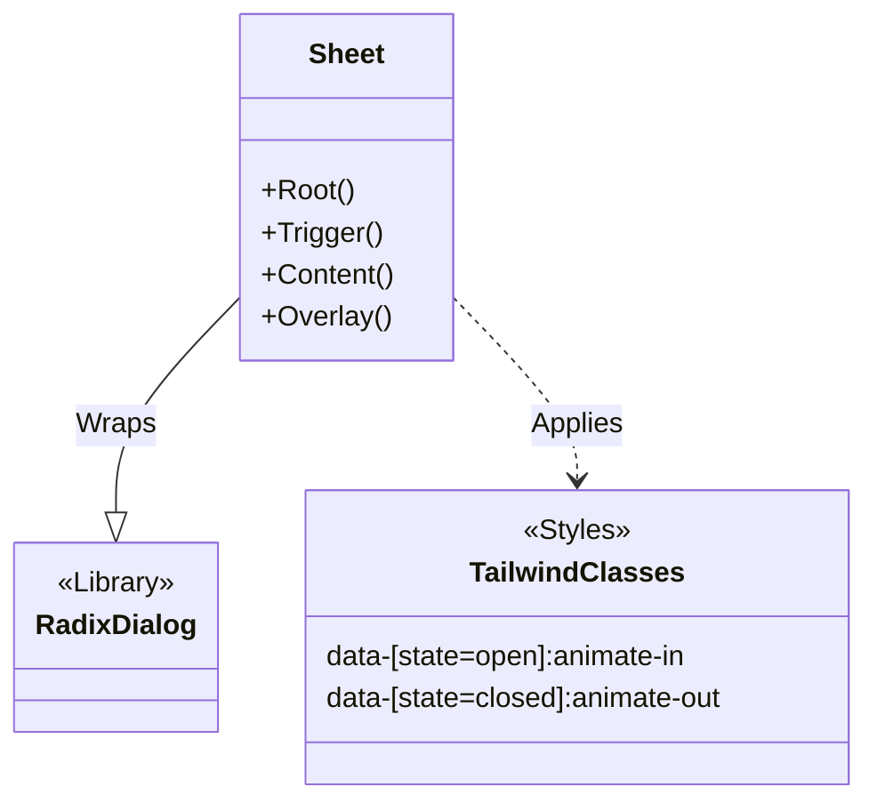

Sources: [app/components/ui/sheet.tsx:1-50](), [package.json:34-45]()

### Common UI Components

| Component        | Underlying Primitive            | Key Features                                           |
| :--------------- | :------------------------------ | :----------------------------------------------------- |
| **DropdownMenu** | `@radix-ui/react-dropdown-menu` | Submenus, checkboxes, portals, animations.             |
| **Sheet**        | `@radix-ui/react-dialog`        | Side panels (left/right/top/bottom), overlay handling. |
| **Tooltip**      | `@radix-ui/react-tooltip`       | Hover information, positioning logic.                  |
| **Tabs**         | `@radix-ui/react-tabs`          | Tab lists, triggers, and content switching.            |
| **Sidebar**      | Custom / Context                | Collapsible, mobile-responsive, context-aware.         |

Sources: [app/components/ui/dropdown-menu.tsx:1-10](), [app/components/ui/sheet.tsx:1-10](), [app/components/ui/tooltip.tsx:1-10](), [app/components/ui/tabs.tsx:1-10]()

---

## Layout & Sidebar System

The application uses a sophisticated Sidebar system defined in `app/components/ui/sidebar.tsx` and implemented in `app/components/layouts/app-sidebar.tsx`.

### Sidebar Architecture

The sidebar supports:

1.  **Collapsibility:** States for expanded, collapsed, and offcanvas (mobile).
2.  **Context:** A `SidebarProvider` (implied usage) likely manages state via Context API.
3.  **Responsiveness:** Mobile triggers and distinct mobile styling.

**Sidebar Component Structure:**

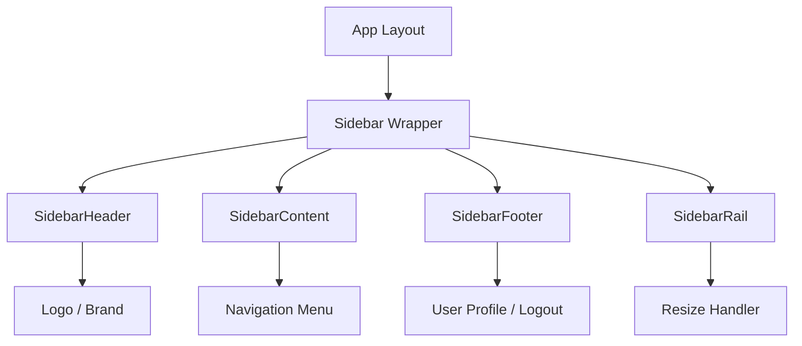

Sources: [app/components/ui/sidebar.tsx:1-50](), [app/components/layouts/app-sidebar.tsx:28-55]()

### Navigation Configuration

Navigation items are defined as data structures containing titles, URLs, icons, and permissions, in `app/lib/navigation.ts`.

```typescript
export const nav: NavItem[] = [
  {
    title: "Dashboard",
    url: "/dashboard",
    icon: Gauge,
    permission: PERMISSIONS.clients.create,
  },
  // ...
];
```

Sources: [app/lib/navigation.ts]()

---

## Data Visualization (Charts)

The project integrates `recharts` via a custom wrapper in `app/components/ui/chart.tsx`. This wrapper standardizes tooltips, legends, and color themes using CSS variables.

### Chart Configuration

Charts use a `ChartConfig` object to map data keys to labels and colors. This abstraction allows charts to respect the global theme (light/dark mode) automatically.

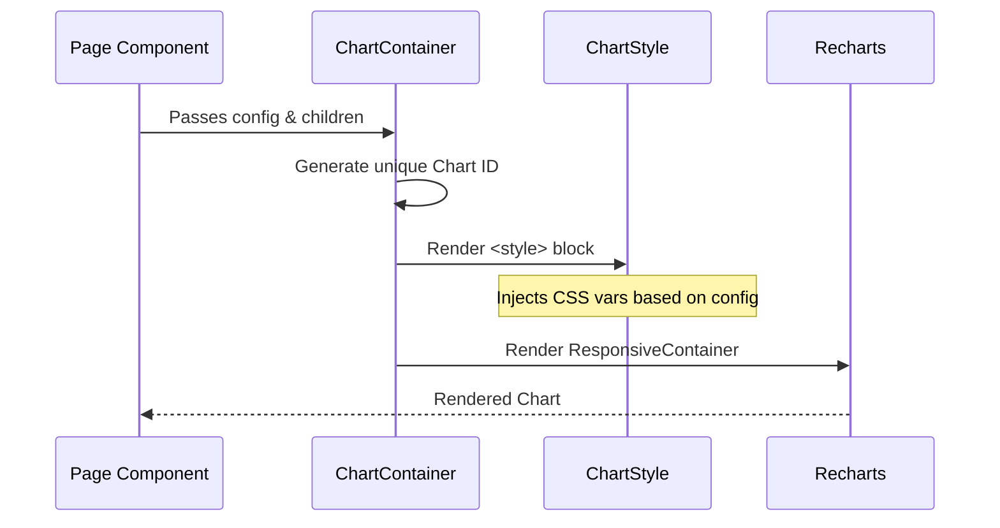

**Features:**

- **Theming:** Supports distinct color maps for light and dark themes.
- **Styling:** Customizes Recharts grid lines, cursors, and text using Tailwind classes like `stroke-border` and `fill-muted`.

Sources: [app/components/ui/chart.tsx:10-60](), [package.json:62]()

---

## Advanced Data Tables

The project implements complex data tables in `app/components/layouts/data-table.tsx` using `@tanstack/react-table`.

### Functionality

- **Sorting:** Uses `getSortedRowModel`.
- **Filtering:** Uses `getFilteredRowModel`.
- **Drag & Drop:** Integrates `@dnd-kit/core` and `@dnd-kit/sortable` for row reordering.
- **Validation:** Uses `zod` for schema definition of row data.

### Drag and Drop Implementation

The table rows are wrapped in `DraggableRow` components (inferred from imports and context) that utilize `useSortable`.

```mermaid
graph TD
    subgraph DndContext
        SortableContext --> Table
        Table --> Row1
        Table --> Row2
        Table --> Row3
    end

    Row1 -->|DragHandle| Sensor[Mouse/Touch/Keyboard Sensor]
    Sensor -->|Event| Handler[onDragEnd]
    Handler -->|Action| Reorder[arrayMove]
```

Sources: [app/components/layouts/data-table.tsx:1-40](), [package.json:20-23]()

---

<a id='tables-pagination'></a>

## Data Tables & Pagination

### Related Pages

Related topics: [Client Management](#client-management)

<details>
<summary>Relevant source files</summary>

The following files were used as context for generating this wiki page:

- [app/components/layouts/paginated-table.tsx](https://github.com/one-premex/iluma.base-front.git/blob/main/app/components/layouts/paginated-table.tsx)
- [app/components/layouts/data-table.tsx](https://github.com/one-premex/iluma.base-front.git/blob/main/app/components/layouts/data-table.tsx)
- [app/lib/pagination.server.ts](https://github.com/one-premex/iluma.base-front.git/blob/main/app/lib/pagination.server.ts)
- [app/routes/(app)/clients/route.tsx](<https://github.com/one-premex/iluma.base-front.git/blob/main/app/routes/(app)/clients/route.tsx>)
- [app/routes/(app)/route.tsx](<https://github.com/one-premex/iluma.base-front.git/blob/main/app/routes/(app)/route.tsx>)
- [package.json](https://github.com/one-premex/iluma.base-front.git/blob/main/package.json)

</details>

# Data Tables & Pagination

## Introduction

The project implements two primary strategies for displaying tabular data: a server-side paginated table (`PaginatedTable`) and a client-side interactive table with drag-and-drop capabilities (`DataTable`). Both implementations leverage `@tanstack/react-table` for core table logic (sorting, filtering, visibility).

The system includes server-side utilities to handle request parsing, fuzzy searching via `fuse.js`, and array slicing, ensuring consistent pagination logic across loaders.

Sources: [app/components/layouts/paginated-table.tsx](), [app/components/layouts/data-table.tsx](), [app/lib/pagination.server.ts]()

## Server-Side Pagination Logic

The pagination logic is centralized in a server-side utility module. This module handles parsing URL search parameters and performing in-memory pagination and searching on data arrays before sending them to the client.

### Core Functions

| Function                  | Description                                                                                                                         |
| :------------------------ | :---------------------------------------------------------------------------------------------------------------------------------- |
| `parsePaginationParams`   | Extracts `page`, `pageSize`, and `search` from `URLSearchParams`. Defaults to page 0 and size 10.                                   |
| `paginateArray`           | Performs fuzzy search (if a search term exists) using `Fuse.js`, calculates total pages, and slices the array for the current page. |
| `paginateArrayFromLoader` | A convenience wrapper that extracts params from the `Request` object and calls `paginateArray`.                                     |

Sources: [app/lib/pagination.server.ts:6-16](), [app/lib/pagination.server.ts:18-48](), [app/lib/pagination.server.ts:50-57]()

### Pagination Data Flow

```mermaid
flowchart TD
    A[Incoming Request] -->|Extract URL| B(parsePaginationParams)
    B -->|Return params| C{Has Search Term?}
    C -- Yes --> D[Fuse.js Search]
    D -->|Filtered Items| E[Calculate Indices]
    C -- No --> E
    E -->|Slice Array| F[Generate Pagination Metadata]
    F --> G[Return PaginationResult]

    subgraph Output Structure
    G --> H[data: Array of T]
    G --> I[pagination: Metadata]
    end
```

Sources: [app/lib/pagination.server.ts:18-48]()

## PaginatedTable Component

The `PaginatedTable` component is designed for datasets where pagination is handled via URL parameters to ensure state persistence and server-side processing.

### Key Features

- **URL-Driven State:** Page navigation and page size changes update the URL query parameters (`?page=X&pageSize=Y`), triggering a loader re-fetch.
- **Debounced Search:** Includes a search input that updates the `search` URL parameter after a 300ms delay.
- **Column Management:** Allows users to toggle column visibility.
- **Sorting:** Supports client-side sorting via TanStack Table.

Sources: [app/components/layouts/paginated-table.tsx:96-107](), [app/components/layouts/paginated-table.tsx:126-137](), [app/components/layouts/paginated-table.tsx:149-160]()

### Component Architecture

```mermaid
sequenceDiagram
    participant User
    participant UI as PaginatedTable
    participant URL as Browser URL
    participant Loader as Server Loader

    User->>UI: Type in Search Input
    UI->>UI: Debounce (300ms)
    UI->>URL: Update ?search=term&page=0
    URL->>Loader: Request with params
    Loader->>Loader: paginateArrayFromLoader()
    Loader-->>UI: Return filtered data & pagination meta
    UI->>User: Display Updated Table

    User->>UI: Click Next Page
    UI->>UI: Calculate nextPageUrl
    UI->>URL: Update ?page=X+1
    URL->>Loader: Request with new page
    Loader-->>UI: Return next slice
```

Sources: [app/components/layouts/paginated-table.tsx:115-125](), [app/routes/(app)/clients/route.tsx:22-33]()

## DataTable Component (Draggable)

The `DataTable` component provides a richer client-side experience, focusing on interactivity such as drag-and-drop reordering and view switching.

### Key Features

- **Drag and Drop:** Uses `@dnd-kit/core` and `@dnd-kit/sortable` to allow row reordering.
- **View Modes:** Includes a Tab interface to switch between "Outline", "Past Performance", etc.
- **Row Selection:** Built-in checkbox selection support.
- **Schema Validation:** Uses `zod` to validate row data structure.

Sources: [app/components/layouts/data-table.tsx:1-25](), [app/components/layouts/data-table.tsx:156-160]()

### Drag and Drop Implementation

The table wraps rows in a `SortableContext` and uses a custom `DraggableRow` component.

```mermaid
classDiagram
    class DataTable {
        +state data
        +handleDragEnd()
    }
    class DndContext {
        +sensors
        +onDragEnd
    }
    class SortableContext {
        +items: dataIds
        +strategy: verticalListSortingStrategy
    }
    class DraggableRow {
        +useSortable(id)
        +transform style
    }
    class DragHandle {
        +listeners
        +attributes
    }

    DataTable --> DndContext : wraps
    DndContext --> SortableContext : wraps
    SortableContext --> DraggableRow : renders
    DraggableRow --> DragHandle : contains
```

Sources: [app/components/layouts/data-table.tsx:103-125](), [app/components/layouts/data-table.tsx:220-227]()

### State Management

Unlike `PaginatedTable`, `DataTable` manages its data state locally for drag operations using `arrayMove`.

1.  **Initialization:** Loads initial data from props.
2.  **Reordering:** `handleDragEnd` detects the active and over elements.
3.  **Update:** Updates the local `data` state using `arrayMove` to swap indices.

Sources: [app/components/layouts/data-table.tsx:143-154]()

## Implementation Examples

### 1. Route with Server-Side Pagination

The `Clients` route demonstrates how to connect the `PaginatedTable` with the server loader.

```typescript
// app/routes/(app)/clients/route.tsx
export const loader = AuthorizedLoaderWithFetcher(
  PERMISSIONS.clients.create,
  async ({ request }, fetch, user) => {
    const todos = await fetch.get<Todo[]>("/todos");
    // Helper processes request params and slices data
    const paginationResult = await paginateArrayFromLoader(
      todos.data || [],
      request,
    );
    return { user, ...paginationResult };
  },
);
```

Sources: [app/routes/(app)/clients/route.tsx]()

### 2. Route with Draggable Table

The Dashboard route uses `DataTable` for interactive data presentation.

```typescript
// app/routes/(app)/dashboard/route.tsx
export default function Page({ loaderData }: Route.ComponentProps) {
  const { data } = loaderData;
  return (
    <>
      <SectionCards />
      <div className="px-4 lg:px-6">
        <ChartAreaInteractive />
      </div>
      {/* Passes full dataset to client-side table */}
      <DataTable data={(data as any) || []} />
    </>
  );
}
```

Sources: [app/routes/(app)/dashboard/route.tsx]()

## Dependencies

The table implementations rely on the following external libraries:

| Library                 | Purpose                                   | Used In                |
| :---------------------- | :---------------------------------------- | :--------------------- |
| `@tanstack/react-table` | Headless table logic (sorting, filtering) | Both                   |
| `@dnd-kit/core`         | Drag and drop primitives                  | `DataTable`            |
| `@dnd-kit/sortable`     | Sortable list logic                       | `DataTable`            |
| `fuse.js`               | Fuzzy searching for server pagination     | `pagination.server.ts` |
| `lucide-react`          | Icons (Chevron, GripVertical, etc.)       | Both                   |

Sources: [package.json:28-30](), [package.json:34](), [package.json:44]()

---

<a id='testing-deployment'></a>

## Testing & Deployment

### Related Pages

Related topics: [Introduction & Setup](#intro-setup)

<details>
<summary>Relevant source files</summary>

The following files were used as context for generating this wiki page:

- [package.json](https://github.com/one-premex/iluma.base-front.git/blob/main/package.json)
- [test/login.test.tsx](https://github.com/one-premex/iluma.base-front.git/blob/main/test/login.test.tsx)
- [app/root.tsx](https://github.com/one-premex/iluma.base-front.git/blob/main/app/root.tsx)
- [app/routes/(app)/clients/route.tsx](<https://github.com/one-premex/iluma.base-front.git/blob/main/app/routes/(app)/clients/route.tsx>)
- [app/components/layouts/data-table.tsx](https://github.com/one-premex/iluma.base-front.git/blob/main/app/components/layouts/data-table.tsx)

</details>

# Testing & Deployment

## 1. Introduction

The `iluma.base-front` project utilizes a modern frontend stack built on React Router v7 and Vite. The testing and deployment strategy is designed to ensure code quality through rigorous unit testing, integration testing, and automated build processes. The system leverages **Vitest** for the testing framework, **React Testing Library** for component interaction, and standard React Router build scripts for deployment preparation.

Testing focuses heavily on route simulation using stubs, ensuring that authentication flows, layout rendering, and error handling work as expected before deployment. The build process transforms the TypeScript/React codebase into a production-ready server-side rendered application.

Sources: [package.json:6-14](), [test/login.test.tsx:1-10]()

## 2. Testing Architecture

### 2.1 Testing Stack and Configuration

The project uses `vitest` as the primary test runner, configured to use `jsdom` as the testing environment. This allows for accurate simulation of browser APIs within the Node.js test execution environment.

| Tool                      | Purpose                       | Context                                                |
| :------------------------ | :---------------------------- | :----------------------------------------------------- |
| **Vitest**                | Main test runner              | Used for unit and integration tests.                   |
| **JSDOM**                 | Browser environment simulator | Provides DOM APIs for React components.                |
| **React Testing Library** | UI testing utility            | Handles component rendering and user event simulation. |
| **React Router Stubs**    | Routing context provider      | Simulates navigation and route loaders/actions.        |

Sources: [package.json:57-75](), [test/login.test.tsx:2-6]()

### 2.2 Test Scripts

The `package.json` defines several scripts to handle different testing scenarios, including continuous integration (CI) and UI-based debugging.

| Script Command   | Description                                                            |
| :--------------- | :--------------------------------------------------------------------- |
| `pnpm test`      | Runs `vitest` in watch mode (default).                                 |
| `pnpm test:ui`   | Opens the Vitest UI for interactive test debugging.                    |
| `pnpm test:ci`   | Runs `vitest --run` (single pass) for CI/CD pipelines.                 |
| `pnpm typecheck` | Runs `react-router typegen` followed by TypeScript compilation checks. |

Sources: [package.json:10-12]()

### 2.3 Route Testing Strategy

The project employs `createRoutesStub` from `react-router` to test route components in isolation while maintaining necessary routing context (loaders, actions, and navigation). This allows tests to simulate URL entries and assert on the resulting UI state.

#### Test Execution Flow

```mermaid
graph TD
    A[Test Runner Vitest] --> B[Load Test File]
    B --> C[Mock External Dependencies]
    C --> D[Create Routes Stub]
    D --> E{Define Route Config}
    E -->|Path| F[login]
    E -->|Component| G[LoginRoute]
    E -->|Action| H[Mock Function]
    D --> I[Render Stub with Initial Entries]
    I --> J[Assert UI State]
    J --> K[Check DOM Elements]
    J --> L[Check Accessibility]
    J --> M[Check Meta Tags]
```

Sources: [test/login.test.tsx:1-20]()

## 3. Component & Integration Testing

### 3.1 Layout and Responsive Design

Tests verify that critical layout classes are applied correctly, ensuring responsive behavior (e.g., hiding elements on smaller screens).

- **Grid Layout:** Verifies the presence of `.grid.min-h-svh.lg:grid-cols-2`.
- **Visibility:** Checks for `.hidden.lg:block` to ensure background sections are managed correctly across breakpoints.

Sources: [test/login.test.tsx:4-40]()

### 3.2 Authentication & Error Handling

The testing suite covers authentication flows, specifically handling error states passed via URL parameters.

#### Error State Logic

```mermaid
sequenceDiagram
    participant Test as Test Runner
    participant Stub as Route Stub
    participant Comp as Login Component

    Note over Test, Comp: Scenario: Unauthorized Access
    Test->>Stub: Render(initialEntries=["/login?error=unauthorized"])
    Stub->>Comp: Mount
    Comp->>Comp: Parse URL Search Params
    alt Error Parameter Present
        Comp->>Comp: Render Alert Component
        Comp-->>Test: Display "You are not authorized"
    else No Error
        Comp-->>Test: Display Standard Login Form
    end
    Test->>Test: Assert Alert Presence
```

Sources: [test/login.test.tsx:45-70]()

### 3.3 Form Interaction & Accessibility

Tests ensure that forms are structurally correct and accessible.

- **Accessibility:** Checks for `role="alert"`, proper heading hierarchy, and `alt` text on images.
- **Form Structure:** Verifies the presence of a `form` with `method="post"` and a submit button.
- **Mocking Actions:** The `action` function is mocked to verify that the authenticator is called with the correct parameters (e.g., "auth0").

Sources: [test/login.test.tsx:150-250]()

## 4. Error Boundaries & Debugging

The application implements a robust `ErrorBoundary` in `app/root.tsx` to handle runtime exceptions and 404s.

### 4.1 Error Handling Logic

The error boundary differentiates between development and production environments, as well as between Route Errors (like 404s) and unexpected Exceptions.

```mermaid
graph TD
    A[Error Occurs] --> B{Is RouteErrorResponse?}
    B -->|Yes| C[Check Status]
    C -->|404| D[Msg: Page not found]
    C -->|Other| E[Msg: Status Text]
    B -->|No| F{Is Dev Mode?}
    F -->|Yes| G[Show Error Message + Stack Trace]
    F -->|No| H[Msg: Unexpected error]
    D --> I[Render Error UI]
    E --> I
    G --> I
    H --> I
    I --> J[Show 'Go Home' & 'Go Back' Buttons]
```

Sources: [app/root.tsx:50-100]()

### 4.2 Technical Details Display

In development mode (`import.meta.env.DEV`), the UI renders a `<details>` block containing the stack trace to assist developers in debugging. This is hidden in production to prevent information leakage.

Sources: [app/root.tsx:64](), [app/root.tsx:110-120]()

## 5. Build & Deployment

### 5.1 Build Scripts

The project uses `react-router` CLI tools for building the application.

| Command      | Description                                                                      |
| :----------- | :------------------------------------------------------------------------------- |
| `pnpm build` | Compiles the application for production using `react-router build`.              |
| `pnpm start` | Serves the built application using `react-router-serve ./build/server/index.js`. |
| `pnpm dev`   | Starts the development server with HMR (Hot Module Replacement).                 |

Sources: [package.json:7-9]()

### 5.2 Code Quality Hooks

To ensure code quality before deployment, the project utilizes `husky` for git hooks and `commitlint` for enforcing commit message conventions.

- **Prepare Script:** `husky` initializes the git hooks.
- **Commit Lint:** `commitlint --edit` ensures commit messages follow the conventional commit format.
- **Lint Staged:** Prettier is run on staged files (`*.{js,css,md,ts,tsx}`) to enforce formatting before commits are finalized.

Sources: [package.json:13-14](), [package.json:79-81]()

## 6. Summary

The `iluma.base-front` repository maintains high reliability through a combination of strict type checking, component-level integration testing via Vitest, and environment-aware error handling. The use of `createRoutesStub` allows for high-fidelity testing of routing logic without requiring a full browser environment. Deployment is streamlined through standard React Router build scripts, while code quality is enforced upstream via Husky and Commitlint.

Sources: [package.json](), [test/login.test.tsx](), [app/root.tsx]()

---
